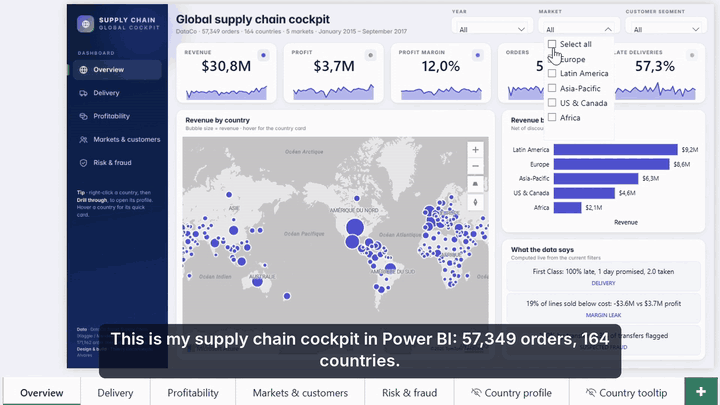
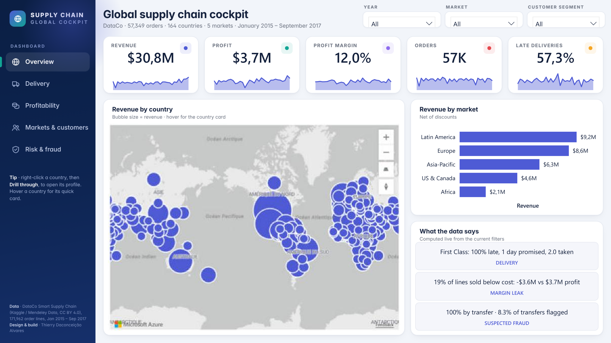
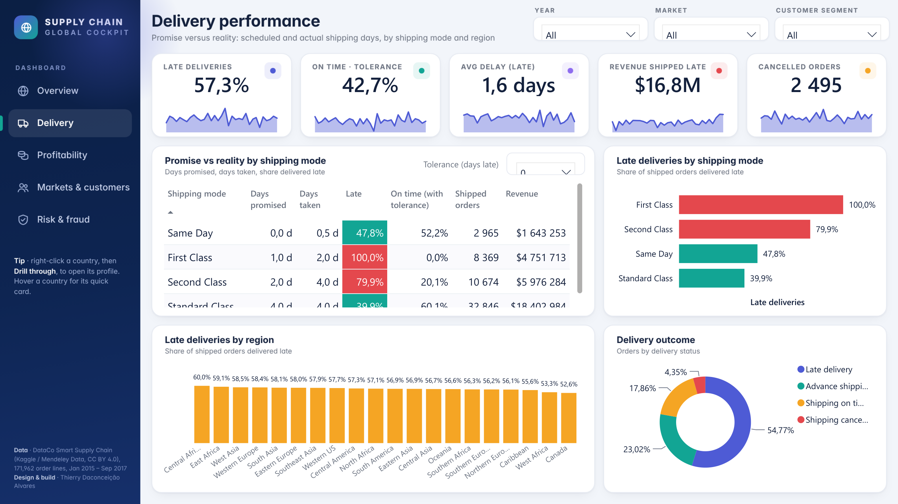
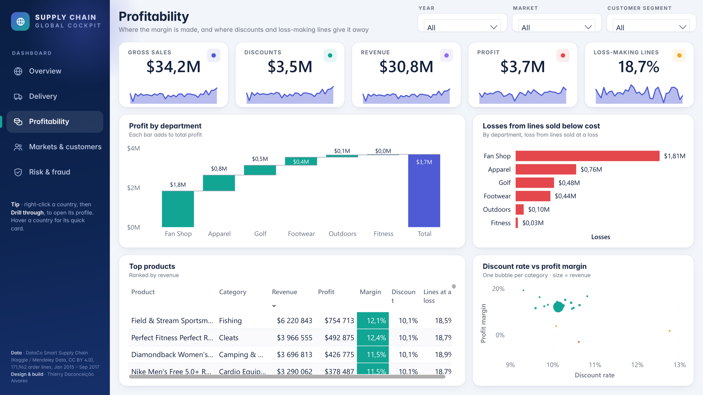
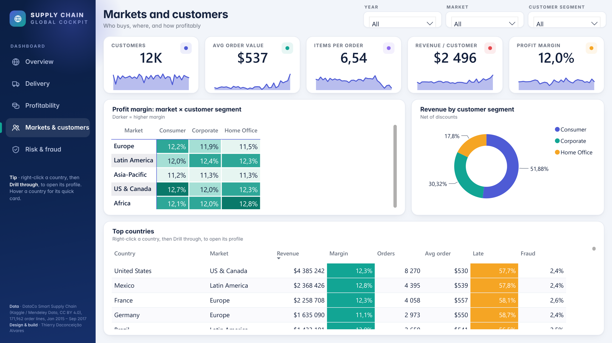
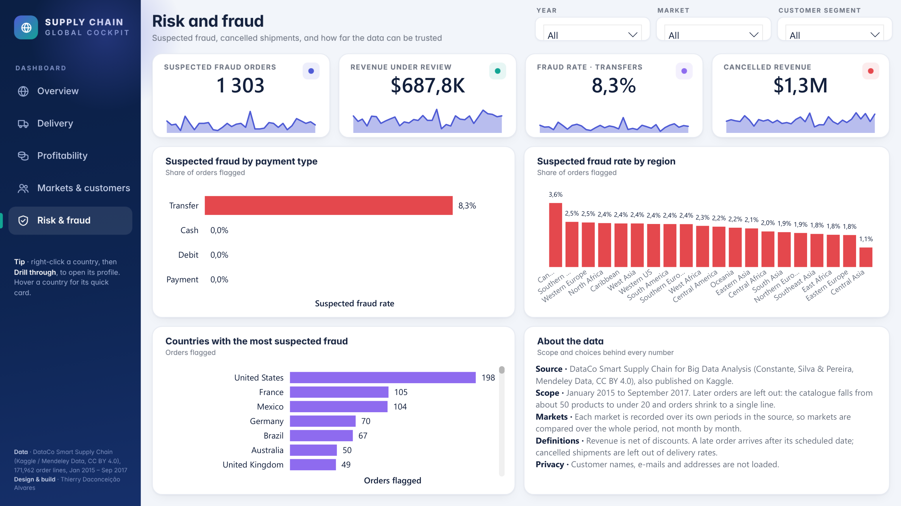

# Global Supply Chain Cockpit · Power BI

A five-page Power BI report on the global supply chain of **DataCo**, a public dataset of
**171,962 order lines, 57,349 orders and 164 countries** (January 2015 – September 2017).

It answers four questions a supply chain or sales director asks every month:
are we delivering on time, where do we lose money, which markets and customers carry the
business, and where is the risk.



**▶ Full walkthrough, Full HD with English subtitles (1 min 23 s):** [docs/media/GlobalSupplyChainCockpit_demo.mp4](docs/media/GlobalSupplyChainCockpit_demo.mp4)

The video is a screen recording of the report in Power BI Desktop: market filter, cross-filtering, the delay-tolerance what-if, page navigation and a drill-through to a country profile.



---

## Key findings

| Topic | What the data says |
|---|---|
| Delivery | **57.3%** of shipped orders arrive late. **First Class is late 100% of the time**: it promises 1 day and takes 2. |
| Geography | Every region is late on **53% to 60%** of its orders: the problem is the promise, not the region. |
| Profitability | Revenue **$30.8M**, profit **$3.7M**, margin **12.0%**. **18.7%** of order lines are sold below cost and lose **$3.6M**. |
| Fraud | **1,303** suspected-fraud orders (**$0.69M**). All of them are paid by bank transfer: **8.3%** of transfer orders are flagged. |
| Cancellations | **2,495** cancelled orders, **$1.3M** of revenue. |

Every number above is computed by the report's DAX measures on the data in `data/`.

## Recommendation

Fix the delivery promise before the network. Every shipping mode takes longer than it promises
(First Class: 1 day promised, 2 taken; Second Class: 2 promised, 4 taken), and every region is
late at the same rate. Allowing one extra day of tolerance raises on-time delivery from 42.7% to
76.3%, and First Class becomes 100% on time.

## The report

| Page | Purpose |
|---|---|
| **Overview** | KPI tiles with sparklines, world map, revenue by market, three insight cards written in DAX |
| **Delivery** | Late rate by shipping mode and region, promised vs. real days, delivery status, a what-if **delay tolerance** |
| **Profitability** | Profit waterfall by department, discount vs. margin by category, losses by department, product table |
| **Markets & customers** | Margin matrix market × segment, revenue by segment, country table |
| **Risk & fraud** | Fraud rate by payment type and region, top countries by fraud, cancelled revenue |
| *Country profile* | Hidden **drill-through** page (right-click a country → Drill through) |



<details>
<summary>More pages</summary>





</details>

### Features worth a look

- **Star schema**: one fact table (`Sales`, one row per order line) and five dimensions
  (`Dates`, `Geography`, `Markets`, `Products`, `ShippingModes`), plus a what-if table.
- **38 DAX measures** in a dedicated `_Measures` table, in display folders.
- **Insights written in DAX**: text cards that rewrite themselves with every filter.
- **Conditional formatting by measure** (late rate and margin colours driven by DAX).
- **What-if parameter**: "on time within N days of tolerance", built with `GENERATESERIES`.
- **Drill-through** country profile (right-click any country, or use the link in its tooltip).
- **Custom design**: theme JSON, navigation rail and page backgrounds drawn in HTML and
  rendered as images, transparent visuals on top.
- **PBIP format**: the semantic model (TMDL) and the report (PBIR JSON) are plain text, so
  every change is visible in Git.

## Data model

```
                 Dates ──┐
              Products ──┤
         ShippingModes ──┼──<  Sales (fact, 171,962 rows)
Markets ──< Geography ───┘
```

| Table | Rows | Grain |
|---|---|---|
| `Sales` | 171,962 | one order line |
| `Geography` | 164 | one country (with market and region) |
| `Products` | 100 | one product |
| `ShippingModes` | 4 | one shipping mode, with its promised days |
| `Markets` | 5 | one market |
| `Dates` | 1,004 | one day |

## Open the report

1. Install **Power BI Desktop** (Windows, free).
2. Clone this repository, for example to `C:\GlobalSupplyChainCockpit`.
3. Open `powerbi/GlobalSupplyChainCockpit.pbip`.
4. If you cloned it somewhere else: **Transform data → Edit parameters → DataFolder**, set it to
   the full path of the `data` folder, then **Refresh**.

The Parquet files in `data/` are included, so no download is needed to open the report.

## Rebuild from the raw data

The whole project is generated by Python scripts, so it can be rebuilt from scratch.

```bash
pip install -r requirements.txt
python -m playwright install chromium                 # only for the page backgrounds

# 1. Download DataCoSupplyChainDataset.csv (link below) into data/raw/
python scripts/prepare_data.py                        # raw CSV -> star schema in Parquet
python scripts/backgrounds.py                         # page backgrounds (PNG)
python scripts/build_pbip.py --data-folder "C:\GlobalSupplyChainCockpit\data"
python scripts/validate.py                            # checks every reference in the report
```

`validate.py` checks, without Power BI, that every table, column and measure used by a visual
or a DAX expression exists in the model. With `--schemas <clone of microsoft/json-schemas>`
it also validates every JSON file against Microsoft's published schemas.

| Script | What it does |
|---|---|
| `prepare_data.py` | Cleans the raw CSV, keeps Jan 2015 – Sep 2017, translates country names, writes the star schema |
| `layout.py` | One shared grid, so backgrounds and visuals line up exactly |
| `backgrounds.py` | Draws the page backgrounds in HTML and renders them with Chromium |
| `build_pbip.py` | Writes the TMDL model, the measures and the 131 visuals of the PBIR report |
| `validate.py` | Reference and schema checks |

## Notes on the data

- **Scope**: orders from 1 January 2015 to 30 September 2017. The last months of the file
  are incomplete and are left out.
- **Markets over time**: in this dataset each market is recorded over its own periods, so
  markets are compared over the whole period, not month by month. The report says so.
- **Late** uses the source flag `Late_delivery_risk` (real shipping days above scheduled days).
  Cancelled orders are excluded from the late rate.
- The dataset is synthetic data published for research; the company name DataCo is fictitious.

## Data source and licence

**DataCo Smart Supply Chain for Big Data Analysis**, Fabian Constante, Fernando Silva,
António Pereira, Mendeley Data, licensed under
[CC BY 4.0](https://creativecommons.org/licenses/by/4.0/).
[Mendeley Data](https://data.mendeley.com/datasets/8gx2fvg2k6) ·
[Kaggle mirror](https://www.kaggle.com/datasets/shashwatwork/dataco-smart-supply-chain-for-big-data-analysis).
The files in `data/` are derived from it (filtered and reshaped).

The code and the report are under the [MIT licence](LICENSE).

## Author

**Thierry Daconceição Alvares** · Data & Business Analyst ·
[GitHub](https://github.com/Thierry-Daconceicao-Alvares)
